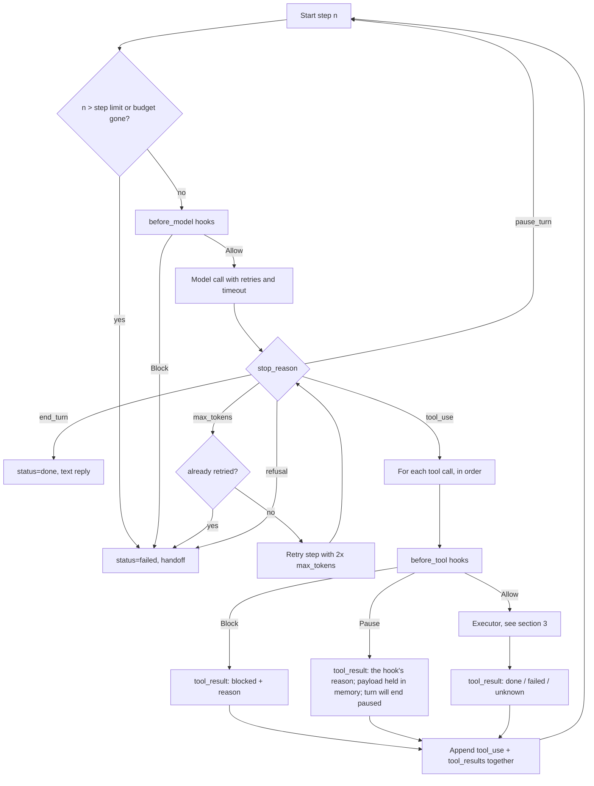
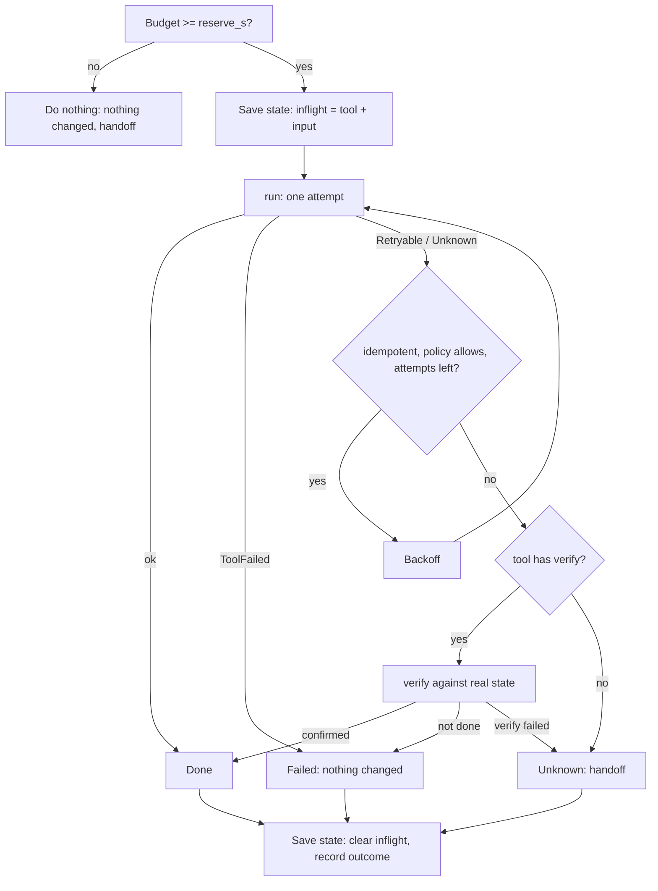

# How a message moves through the system

Status: design for Phase 1. Built so far: commits 1 to 7 of 8 (everything in agentcore except the measure script). Sections 2 and 3 below are implemented; section 1 needs the router and service (Phase 2). The diagrams below are not implemented yet. Updated in the same commit as the code it describes.
Blocks marked (P2) and (P3) arrive in later phases.

## 1. One `/chat` turn

```mermaid
flowchart TD
    A[POST /chat: session_id, phone, message] --> B[Load session state + history]
    B --> C{state.inflight set?}
    C -- yes --> C1[Run that tool's verify, record outcome]
    C -- no --> D
    C1 --> D[Add untold outcomes to context as text]
    D --> E[Emergency check, before the router (P3)]
    E -- emergency --> X[Fixed reply: call 108, emergency=true, handoff]
    E -- ok --> F[Router: haiku picks an agent (P2)]
    F --> G[Specialist agent loop]
    G --> H{Loop result}
    H -- end_turn --> I[Commit history + save state]
    H -- paused --> I
    H -- failed --> J[Roll back history, keep state, reply from outcomes + handoff]
    I --> K[Reply: reply, agent, handoff, emergency, trace_id]
    J --> K
```

## 2. The agent loop (agentcore)



Notes on section 2: a `max_tokens` retry counts as a step against the step limit; the paused payload is written to the session state only when the turn ends paused, together with the history that holds the read-back, never when the hook pauses; a failed turn drops the history but keeps what the executor saved.

## 3. The tool executor (one atomic unit for a write)



The whole box from `Save state: inflight` to `record outcome` runs shielded: a budget timeout or a client disconnect can't stop it halfway.

## 4. What is stored where

| Thing | Where | Lifetime | Rolled back on a failed turn? |
|---|---|---|---|
| Messages (history) | SessionStore | 30 min idle | yes |
| `state`: pending payload, inflight, outcomes, caches | SessionStore | 30 min idle | **no** |
| Trace events | TraceStore (LRU + JSONL) | outlives the session | no |

## 5. Who owns what

- `agentcore/`: loop, registry, executor, hooks mechanism, trace, stores. No hospital words, no hospital imports.
- `agent_service/`: hospital client, tools, prompts, hooks (ownership, confirmation, 4-hour rule, emergency, one write per turn), router, agents.
