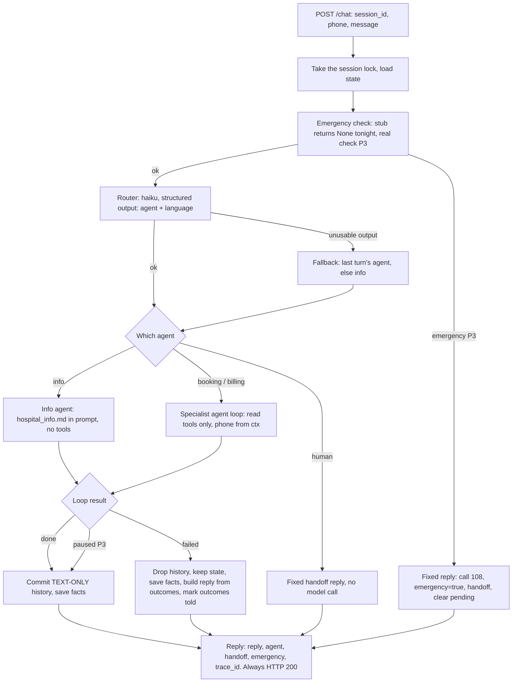
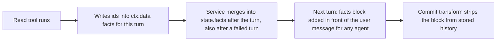
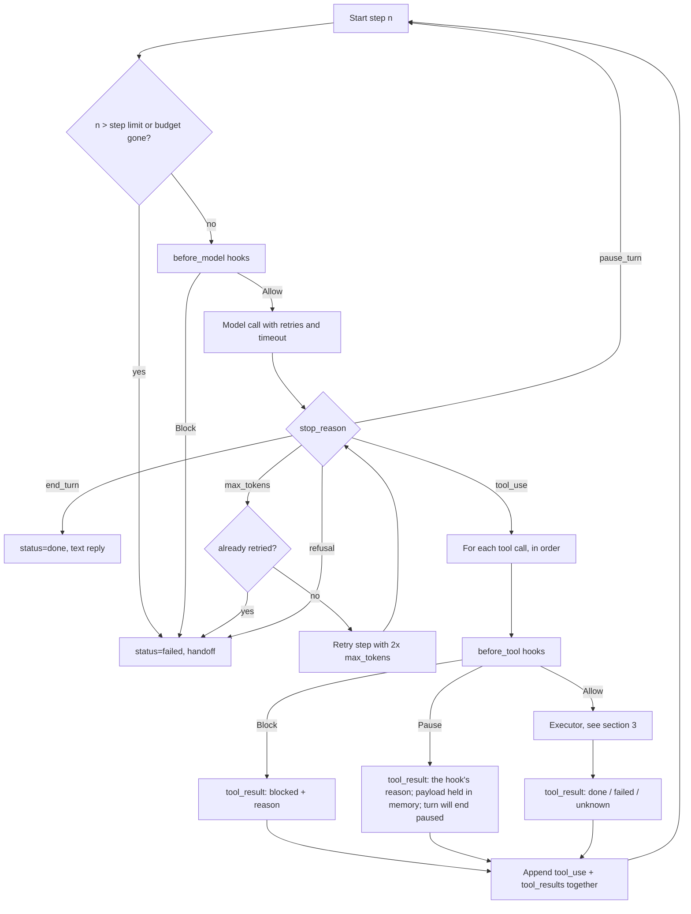
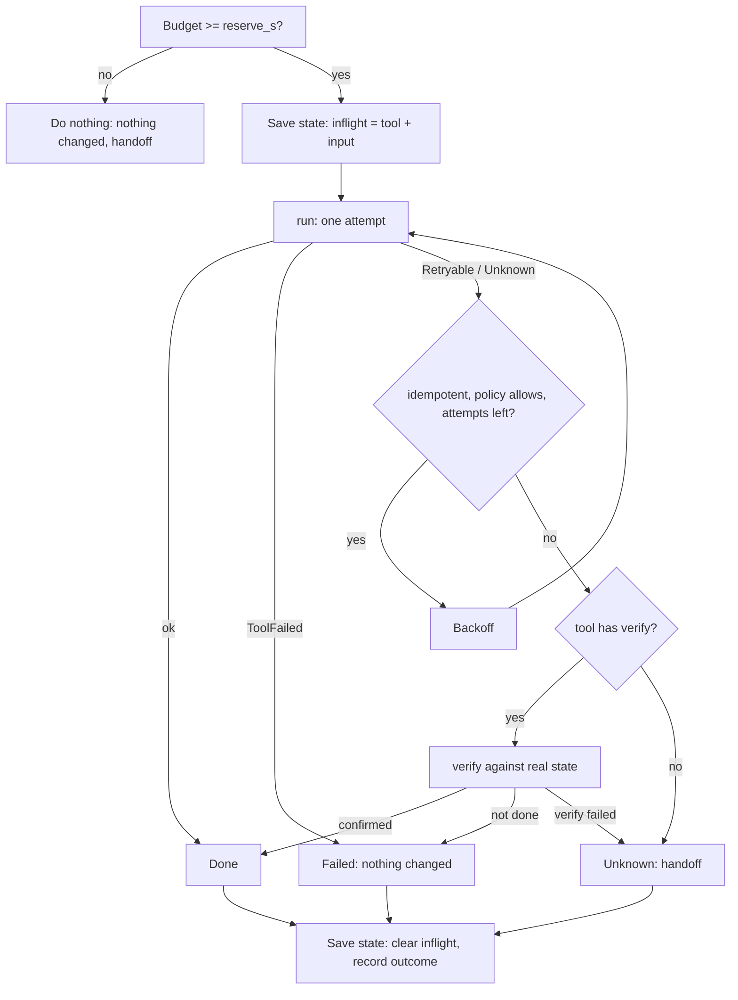
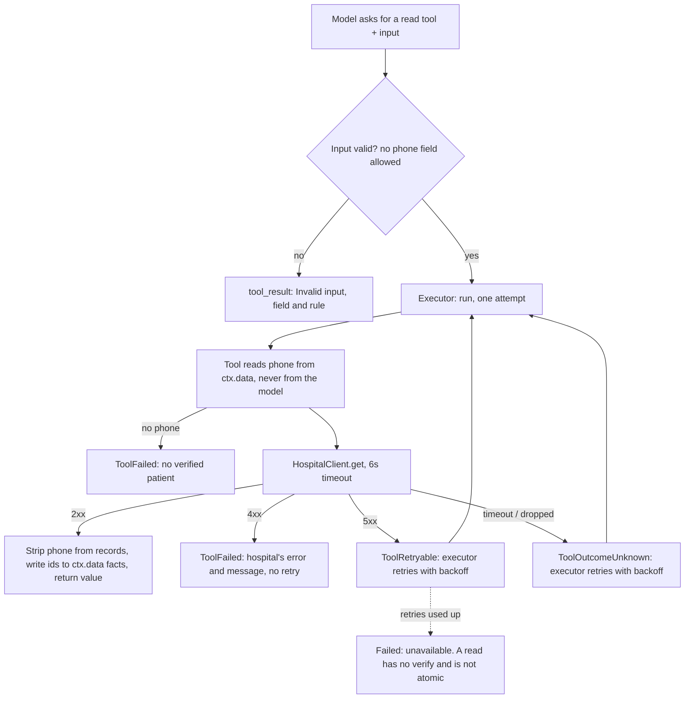
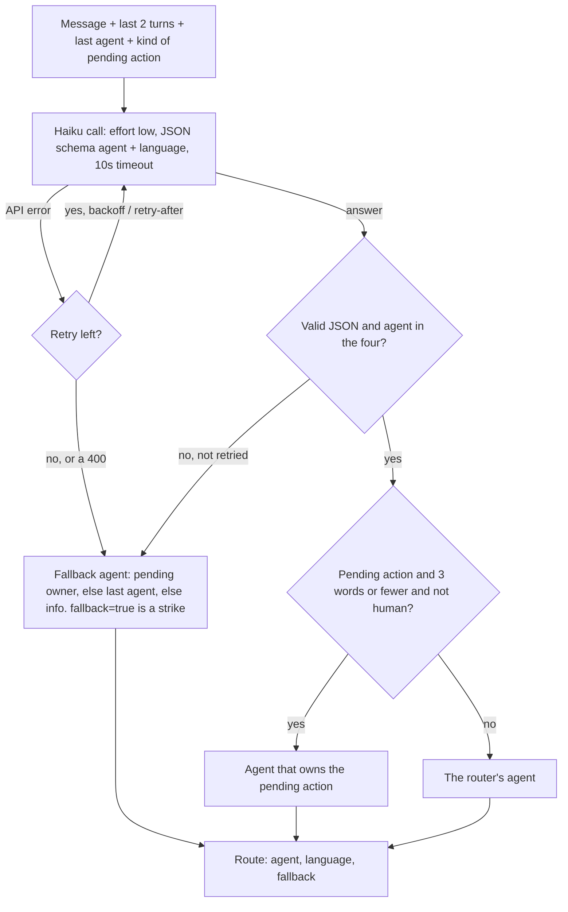

# How a message moves through the system

Status: Phase 2 design agreed (docs/design-log.md, 2.1 to 2.10). Built so far: agentcore (Phase 1, complete) and Phase 2 commits 1 to 3 (hospital client and read tools, section 6; `lock_held` and `history_transform` on the loop, see the notes under section 2; the router, section 7). Sections 2 and 3 are implemented; section 1 is the Phase 2 design, built in six commits (2.10). Updated in the same commit as the code it describes.
Blocks marked (P2) are built tonight, (P3) in Phase 3.

## 1. One `/chat` turn (Phase 2 design)

The service takes the session lock once for the whole turn. `run_turn` is told the lock is already held (commit 2), so it does not lock again.

What the specialist receives each turn: its own system prompt and tools (stable, cached), the shared text-only history, and a marked "known facts" block (ids of doctors, slots, appointments, bills from earlier turns) in front of the user message. The facts block is stripped when the history is committed.

Known limit: one agent per turn. A message with two topics gets one answered, and the reply tells the patient to ask the other next.

### 1b. The facts note

## 2. The agent loop (agentcore)

Notes on section 2: a `max_tokens` retry counts as a step against the step limit; the paused payload is written to the session state only when the turn ends paused, together with the history that holds the read-back, never when the hook pauses; a failed turn drops the history but keeps what the executor saved.

Two options on `run_turn` (Phase 2 commit 2): `lock_held=True` skips taking the session lock when the caller already holds it. `history_transform` is applied to the messages only at commit time (done or paused), after which the store's pairing check runs; the model sees the untransformed messages during the turn. A transform that raises fails the turn as `history_invalid` and stores nothing.

## 3. The tool executor (one atomic unit for a write)

The whole box from `Save state: inflight` to `record outcome` runs shielded: a budget timeout or a client disconnect can't stop it halfway.

## 4. What is stored where

| Thing | Where | Lifetime | Rolled back on a failed turn? |
|---|---|---|---|
| Messages (history) | SessionStore | 30 min idle | yes |
| `state`: pending payload, inflight, outcomes, caches | SessionStore | 30 min idle | **no** |
| Trace events | TraceStore (LRU + JSONL) | outlives the session | no |

## 5. Who owns what

- `agentcore/`: loop, registry, executor, hooks mechanism, trace, stores. No hospital words, no hospital imports.
- `agent_service/`: hospital client, tools, prompts, hooks (ownership, confirmation, 4-hour rule, emergency, one write per turn), router, agents.

## 6. One read tool call (built, Phase 2 commit 1)

## 7. The router (built, Phase 2 commit 3)

Every attempt is a `model_call` trace event (role router) with tokens and cost. Unusable answers are marked `unusable`.
