# How a message moves through the system

Status: everything in this file is built and was exercised by the three reported chaos runs on commit `21b4690` (EVALS.md). The sections follow the order they were built: agentcore (sections 2 and 3, Phase 1), the service (sections 1 and 6 to 9, Phase 2: hospital client and read tools, router, agents and the facts note, `/chat` and the trace endpoint) and the safety pieces (the "Phase 3" sections at the end: the confirmation gate, the 4-hour rule, handoffs and strikes, the next-slot offer, the second yes layer). Section 1 is the whole turn as built. Updated in the same commit as the code it describes.

Headings such as "(built, Phase 2 commit 4)" say when a piece was first built; their contents were brought up to date for Phase 3 (tool lists, the pause path).

## 1. One `/chat` turn

The service takes the session lock once for the whole turn. `run_turn` is told the lock is already held (commit 2), so it does not lock again.

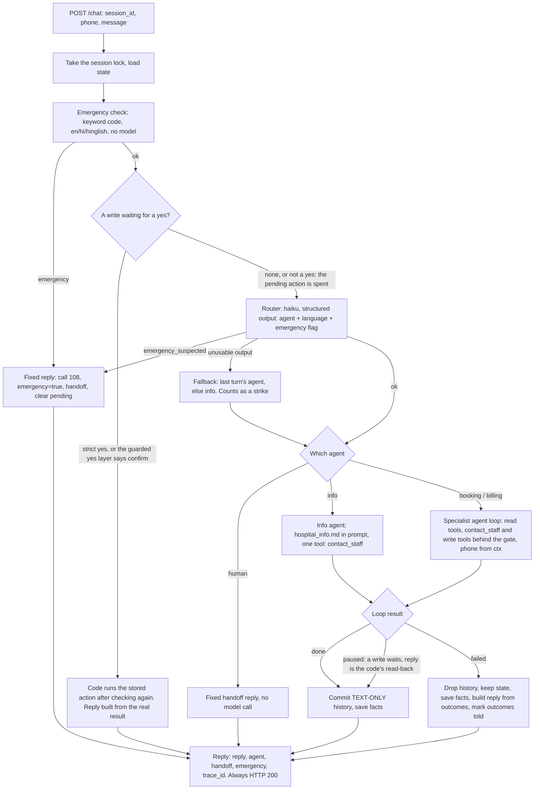

What the specialist receives each turn: its own system prompt and tools (stable, cached), the shared text-only history, and a marked "known facts" block (ids of doctors, slots, appointments, bills from earlier turns) in front of the user message. The facts block is stripped when the history is committed.

Known limit: one agent per turn. A message with two topics gets one answered, and the reply tells the patient to ask the other next.

### 1b. The facts note

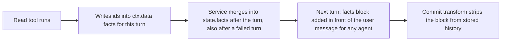

## 2. The agent loop (agentcore)

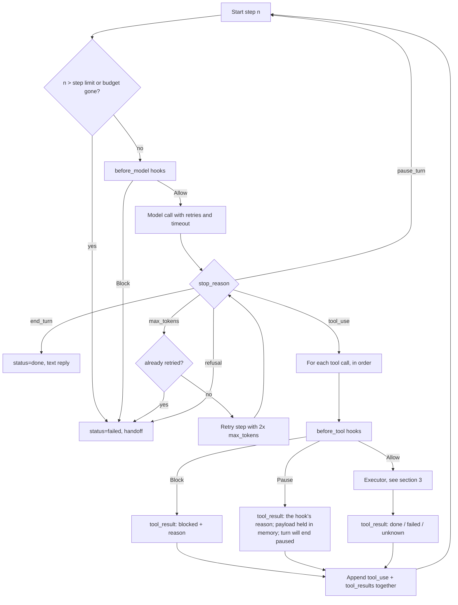

Notes on section 2: a `max_tokens` retry counts as a step against the step limit; the paused payload is written to the session state only when the turn ends paused, together with the history that holds the read-back, never when the hook pauses; a failed turn drops the history but keeps what the executor saved.

Two options on `run_turn` (Phase 2 commit 2): `lock_held=True` skips taking the session lock when the caller already holds it. `history_transform` is applied to the messages only at commit time (done or paused), after which the store's pairing check runs; the model sees the untransformed messages during the turn. A transform that raises fails the turn as `history_invalid` and stores nothing.

## 3. The tool executor (one atomic unit for a write)

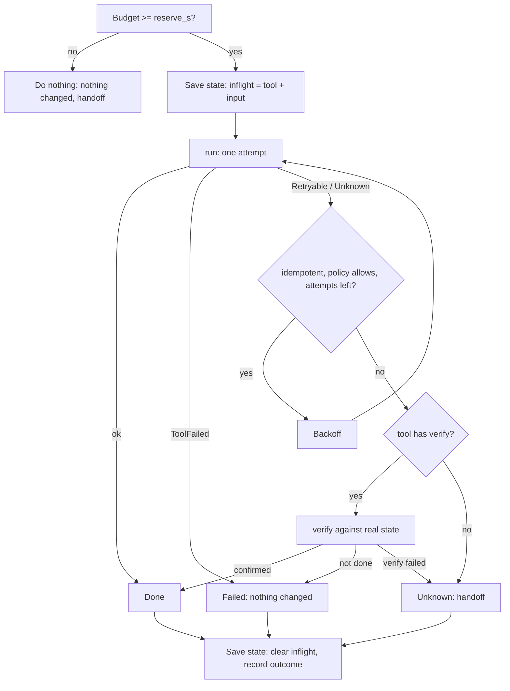

The whole box from `Save state: inflight` to `record outcome` runs shielded: a budget timeout or a client disconnect can't stop it halfway.

## 4. What is stored where

| Thing | Where | Lifetime | Rolled back on a failed turn? |
|---|---|---|---|
| Messages (history) | SessionStore | 30 min idle | yes |
| `state`: pending payload, inflight, outcomes, caches | SessionStore | 30 min idle | **no** |
| Trace events | TraceStore (LRU + JSONL) | outlives the session | no |

## 5. Who owns what

- `agentcore/`: loop, registry, executor, hooks mechanism, trace, stores. No hospital words, no hospital imports.
- `agent_service/`: hospital client, tools (reads, `contact_staff`, the four write tools), prompts, the confirmation gate (one `before_tool` hook: ownership, confirmation, the 4-hour rule), the emergency check (plain code in the service, before the router, not a hook), the second yes layer, router, agents. There is no separate "one write per turn" hook: the first write call pauses the turn, a later call in the same step is skipped, any tool call after the pause is refused, and a second attempt fails the turn to a handoff (`agentcore/loop.py`, tested in `tests/test_confirm.py`).

## 6. One read tool call (built, Phase 2 commit 1)

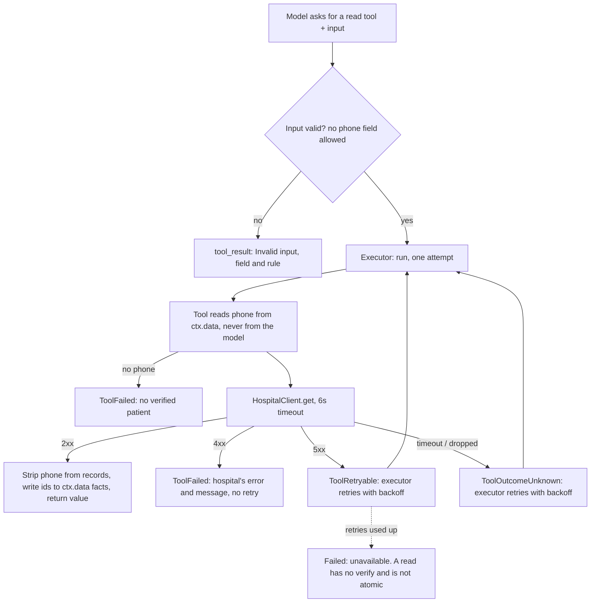

## 7. The router (built, Phase 2 commit 3)

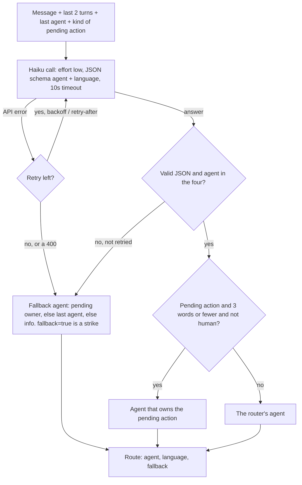

Every attempt is a `model_call` trace event (role router) with tokens and cost. Unusable answers are marked `unusable`.

## 8. What one specialist call receives (built, Phase 2 commit 4; tool lists as of Phase 3)

```mermaid
flowchart LR
    subgraph Cached prefix: identical for every patient and turn
        SP[System prompt: common rules + job. Info also holds hospital_info.md]
        TL[Tool list. info: contact_staff. booking: find_doctors, free_slots, list_appointments, contact_staff + book, reschedule, cancel. billing: list_bills, contact_staff + create_payment_link]
    end
    subgraph Per turn, after the prefix
        H[History: text only, patient words + replies the patient saw]
        FN[Facts note: hospital time, doctor, slot, appointment, bill ids]
        UM[Patient message, markers broken]
    end
    SP --> M[Model call]
    TL --> M
    H --> M
    FN --> M
    UM --> M
    M --> C[Commit: text_only drops tool traffic, thinking, the note and unseen pre-tool text]
```

Human handoff makes no model call: the reply is a fixed text in the patient's language, `handoff: true`.

## 9. `/chat` as built (Phase 2 commit 5)

```mermaid
flowchart TD
    A[POST /chat: session_id, phone, message] --> K[Storage key = sha256 of phone + session_id]
    K --> L[Take that key's lock, load history + state]
    L --> E{emergency check: keyword code (agent_service/emergency.py)}
    E -- hit --> X[Clear pending, fixed reply, agent safety, emergency + handoff]
    E -- none --> R[Router, same Tracer]
    R -- human --> H[Fixed reply in the patient's language, handoff true]
    R -- booking --> T[Fetch /now, build facts note]
    R -- billing / info --> N[Build facts note, no clock]
    T --> S[run_turn: lock_held, text_only, same Tracer]
    N --> S
    S -- done --> OK[Reply = model text, handoff = escalate]
    S -- failed --> F{Outcomes saved?}
    F -- unknown --> HO[Human text, handoff]
    F -- done --> DN[It went through, couldn't finish the reply. Outcomes marked told]
    F -- none, escalate --> HO
    F -- none --> FR[Fixed failure text, no handoff]
    OK --> SV[Save facts, last agent, language]
    DN --> SV
    HO --> SV
    FR --> SV
    SV --> Z[ChatResponse: reply, agent, handoff, emergency, trace_id. Always 200]
    X --> Z
    H --> Z
    A -. any exception anywhere .-> LR[Human reply en, handoff true, stop event internal] --> Z
```

`GET /trace/{session_id}`: every event of the session (router and specialist share one trace id per turn) and the totals over all turns. Traces are filed under the request's session id, state under the hashed key, so one session id used by two phones is two conversations with one shared trace list.

## Phase 3: a write (commit 3)

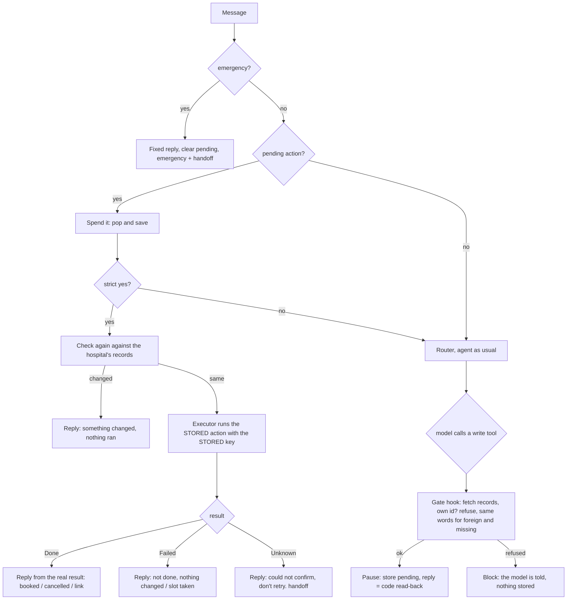

## Phase 3: handoffs and strikes (commit 4a)

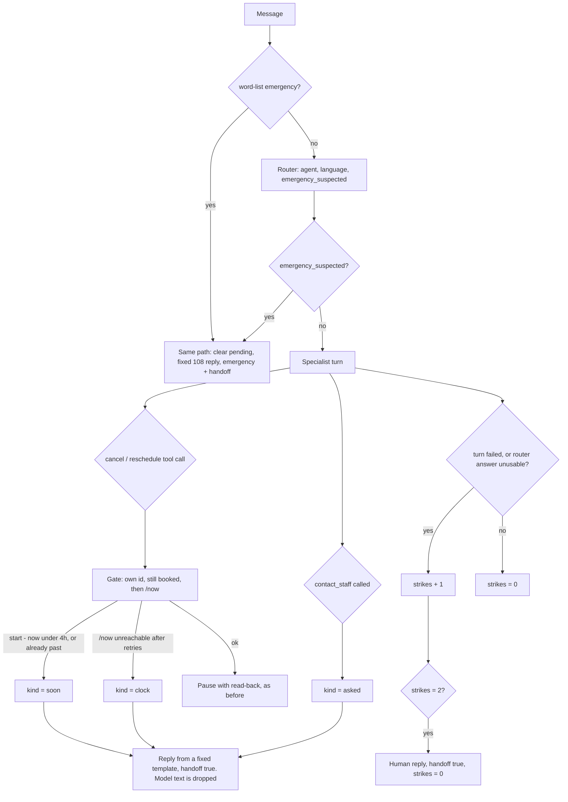

At the yes the gate checks again, so an appointment that moved inside 4 hours after the read-back goes to staff instead of running.

## Phase 3: how the write tools reach an agent (commit 4b)

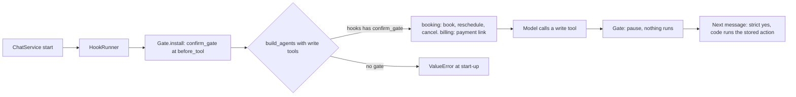

## Phase 3: a lost race on a booking (fix 2)

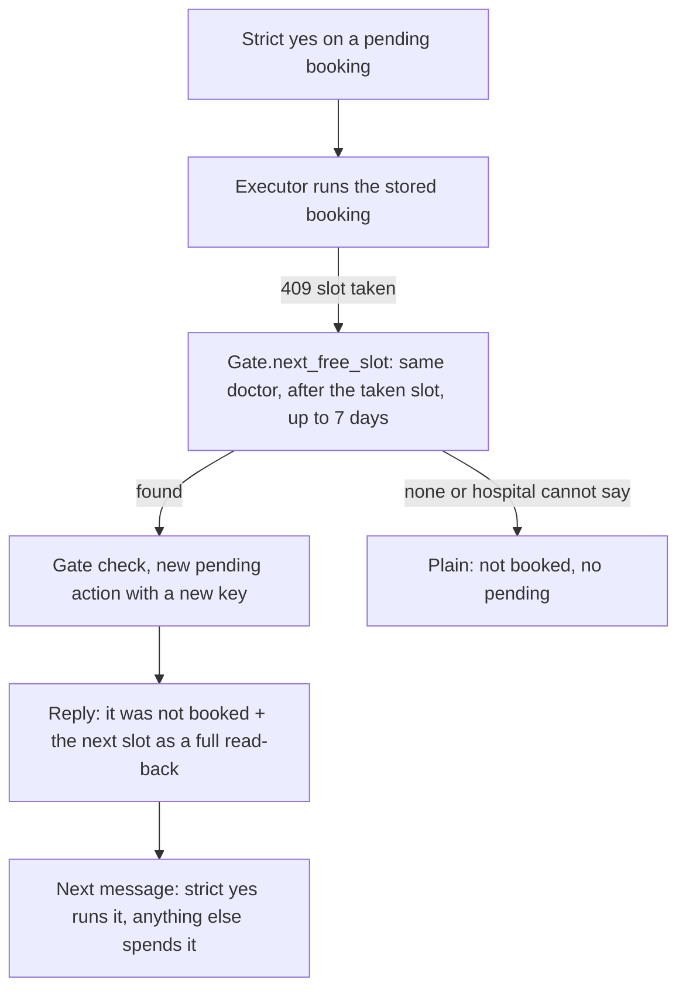

## Phase 3: the second yes layer (fix 3)

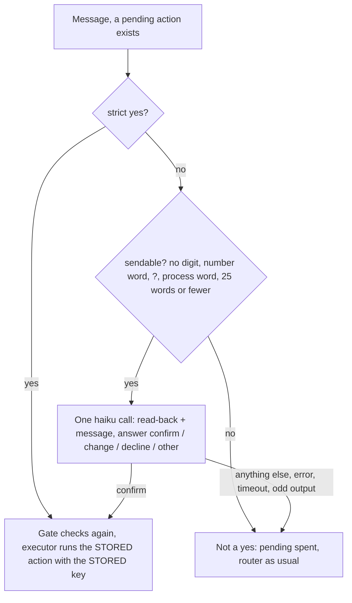
